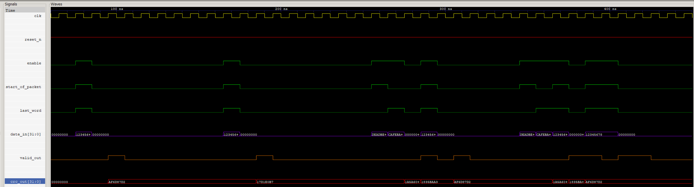

# High-Performance Parallel Pipeline CRC32 Accelerator

## 1. Introduction
This project implements a high-speed, hardware-based **CRC32 (Cyclic Redundancy Check)** accelerator using SystemVerilog.  
Unlike traditional serial implementations that process one bit per cycle, this design utilizes a **parallel architecture** to process **32-bit data chunks per clock cycle**.

The CRC computation is compatible with the Ethernet CRC32 definition (IEEE 802.3), using LSB-first logic and standard initialization/finalization.  
By utilizing a bit-reversed polynomial internally (`0xEDB88320`), the engine achieves maximum throughput without requiring complex manual bit-reversal logic at the I/O.

---

## 2. Key Features
- **Parallel Processing:** Computes CRC for full 32-bit words in a single clock cycle using a combinational XOR loop.
- **Two-Stage Pipeline:** An input sampling register stage plus a registered CRC state decouple the XOR network from the input source and from the output.
- **Standard Compliance:** Verified against a golden vector cross-checked with `zlib.crc32` (IEEE 802.3 CRC-32)  
  (`0x12345678 → 0xAF6D87D2`, word bytes taken little-endian).
- **Zero-Wait Operation:** Supports back-to-back packet processing (tested with no idle cycle between packets).
- **Protocol Assertions:** SystemVerilog concurrent assertions (SVA) check protocol, latency and hold behavior (enabled with `+define+CRC_ASSERT`). Simple immediate checks remain as a fallback for simulators without SVA support.

---

## 3. Architecture Overview
The design implements a high-efficiency CRC calculation engine with **two register stages** (`valid_out` is seen 2 clock edges after `last_word` is sampled).


### 3.1 Input Sampling Stage
All inputs (`data_in`, `enable`, `start_of_packet`, `last_word`) are captured into internal pipeline registers on the rising edge of `clk`.  
This isolates the combinational XOR logic from external input timing paths and ensures clean signal timing.

### 3.2 CRC Calculation Engine
The core logic emulates a **parallel Linear Feedback Shift Register (LFSR)**:

- **Logic:** A combinational `for` loop computes the next CRC state from the current state and incoming 32-bit data.
- **Polynomial:** Uses the Ethernet generator polynomial in reversed form (`0xEDB88320`).
- **Initialization:** On `start_of_packet`, the CRC register is preset to `0xFFFFFFFF`.
- **Finalization:** The internal CRC state is bitwise inverted (`~`) before driving `crc_out`.

---

## 3.3 Pipeline & Latency Profile
The CRC engine operates as a streaming datapath with registered inputs and a registered CRC state, resulting in a two-cycle latency.

### Latency Summary
- **Throughput:** 32 bits per clock cycle
- **Latency:** 2 clock cycles
- **Output timing:** `valid_out` is seen 2 clock edges after `last_word` is sampled (checked by the `a_latency` assertion)
- **Back-to-back frames:** Fully supported


### Textual Pipeline Diagram
```text
Edge 0:
  enable = 1
  data_in = Wk
  start_of_packet / last_word asserted
  └── Inputs captured into pipeline registers

Edge 1:
  └── LFSR_Q updated with LFSR_NEXT (when enable_pipe asserted)
  └── crc_out = ~LFSR_Q
  └── valid_out register set

Edge 2:
  └── valid_out is seen high (a_latency: last_word |-> ##2 valid_out)
```

## 3.4 Scaling to Higher Frequencies (Deeper Pipelining)

The current implementation computes the full 32-bit CRC update in a single combinational cycle. For higher clock frequency targets (Fmax), the pipeline can be extended as follows:

### Option A: Multi-Stage Bit Processing
- Split the 32-bit update loop into multiple pipeline stages (e.g., 8+8+8+8 bits).
- Insert registers between stages to shorten the critical path.
- **Trade-off:** Latency increases proportionally to the number of stages added.

### Option B: Matrix-Based CRC Computation
- Replace the iterative loop with a precomputed linear transformation matrix.
- This approach allows for logic optimization that is often faster than a deep `for` loop in FPGA/ASIC synthesis.
- next_crc is computed as a fixed XOR network derived from CRC linearity


## 4. Interface Description

| Signal Name | Direction | Width | Description |
| :--- | :--- | :--- | :--- |
| **clk** | Input | 1-bit | **System Clock**. All internal logic and pipeline stages trigger on the rising edge. |
| **reset_n** | Input | 1-bit | **Asynchronous Active-Low Reset**. Forces the CRC state to 0xFFFFFFFF and clears all control registers. |
| **enable** | Input | 1-bit | **Clock Enable**. Data is only sampled and processed by the engine when this signal is high. |
| **start_of_packet** | Input | 1-bit | **Sync Signal**. Resets the internal LFSR to the initialization value for a new frame. |
| **last_word** | Input | 1-bit | **End of Frame Indicator**. Marks the final data word; triggers the calculation finalization. |
| **data_in** | Input | 32-bit | **Data Payload**. The 32-bit word to be processed in the current clock cycle. |
| **crc_out** | Output | 32-bit | **CRC Result**. The final calculated and inverted checksum. |
| **valid_out** | Output | 1-bit | **Result Ready**. Indicates `crc_out` contains a valid result (seen 2 clock edges after `last_word` is sampled). |

### Control Signals & Reset Behavior
The CRC engine's state is governed by a strict hierarchy between the reset, enable, and start-of-packet signals:
* **System Reset (`reset_n`):** This is an asynchronous active-low reset. When asserted (LOW), it immediately clears the pipeline and forces the internal CRC register to the initialization seed (`0xFFFFFFFF`), completely independent of the clock or the `enable` signal.
* **Hold State (`enable` LOW):** If the `enable` signal is LOW, the entire engine freezes. The current CRC state is held, the pipeline is paused, and any changes on `data_in` or assertions of `start_of_packet` are **completely ignored** until `enable` goes HIGH again.
* **Frame Initialization (`start_of_packet`):** This synchronously resets the CRC calculation for a new frame. Because of the hold state logic, `start_of_packet` is **only evaluated when `enable` is HIGH**.

## 5. Verification & Simulation
The project includes a comprehensive, self-checking SystemVerilog Testbench (`tb_crc32.sv`) covering:
* **Pipeline Latency:** Checks the 2-cycle delay between `last_word` and `valid_out` (SVA `a_latency`).
* **Standard Compliance:** Validated against a reference model and the golden vector `0x12345678`.
* **One-Bit Change:** `0x12345679` must produce `0x17D1E0B7`, different from the golden CRC.
* **Back-to-Back Packets:** Directed and randomized packet pairs with no idle cycle between them.
* **Randomized Traffic:** Automated testing with varying packet lengths and random data.
* **Assertions (SVA):** protocol (`start_of_packet` / `last_word` only with `enable`), latency, no spurious `valid_out`, state hold while idle, plus cover points for back-to-back and gapped frames.

The reference model in the testbench matches the RTL bit-for-bit,
ensuring functional equivalence across all tested scenarios.

### Results (Cadence Xcelium, EDA Playground)

| Run | Compile options | Result |
| :--- | :--- | :--- |
| Clean | `+define+CRC_ASSERT` | `SUCCESS`: 50 packets passed, 0 SVA failures |
| Fault injection: late `valid_out` | `+define+CRC_ASSERT+INJECT_LATENCY_BUG` | `FAILURE`: 94 SVA failures (`a_latency`, `a_no_spurious_valid`) + 11 scoreboard errors |
| Fault injection: wrong CRC bit | `+define+CRC_ASSERT+INJECT_CRC_BUG` | `FAILURE`: 52 scoreboard/golden errors, 0 SVA failures |

The two injected faults are caught by different checkers: the SVA catches the timing fault even where the CRC value is still correct, and the scoreboard catches the value fault.

### Simulation Waveform Analysis



**Analysis of Results:**
1. **Standard Compliance:** When `data_in` is `0x12345678`, the output `0xAF6D87D2` appears two clock edges after the word is sampled, matching the reference model.
2. **One-Bit Change:** A single bit change in the input (from `0x12345678` to `0x12345679`) changes the CRC to `0x17D1E0B7`, which the testbench checks automatically.

## 6. File Description
* `CRC32_parallel_pipeline.sv`: The synthesizable RTL design module (includes the optional SVA block and fault-injection switches).
* `tb_crc32.sv`: Self-checking testbench with automated scoreboard and error reporting.
* `results/`: Simulation logs of the runs above.

## 7. Tools Used
* **Language:** SystemVerilog (IEEE 1800-2012)
* **Simulation (SVA):** Cadence Xcelium (EDA Playground)
* **Simulation (no SVA):** Icarus Verilog (iverilog)
* **Waveform Analysis:** GTKWave

## 8. How to Run Simulation
```bash
# Xcelium (SVA enabled)
xrun +define+CRC_ASSERT -coverage functional CRC32_parallel_pipeline.sv tb_crc32.sv

# Fault injection (expected: FAILURE)
xrun +define+CRC_ASSERT+INJECT_LATENCY_BUG CRC32_parallel_pipeline.sv tb_crc32.sv
xrun +define+CRC_ASSERT+INJECT_CRC_BUG     CRC32_parallel_pipeline.sv tb_crc32.sv
```

```bash
# Icarus Verilog (no SVA, immediate checks only)
# 1. Compile the design and testbench
iverilog -g2012 -o crc_sim tb_crc32.sv CRC32_parallel_pipeline.sv

# 2. Run the simulation
vvp crc_sim

# 3. View Waveforms
gtkwave waves.vcd
```